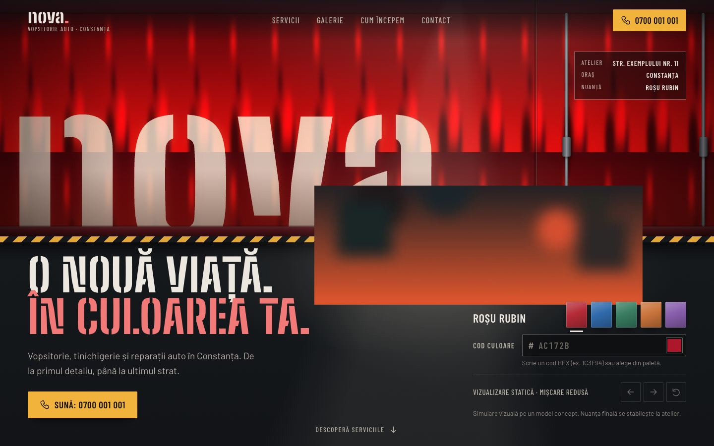
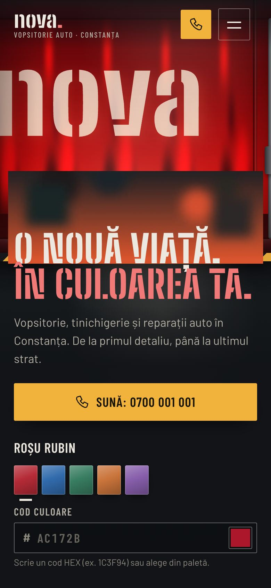
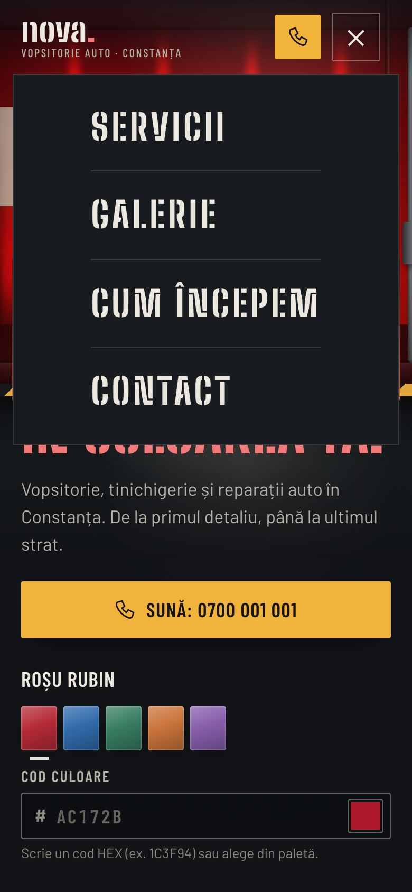
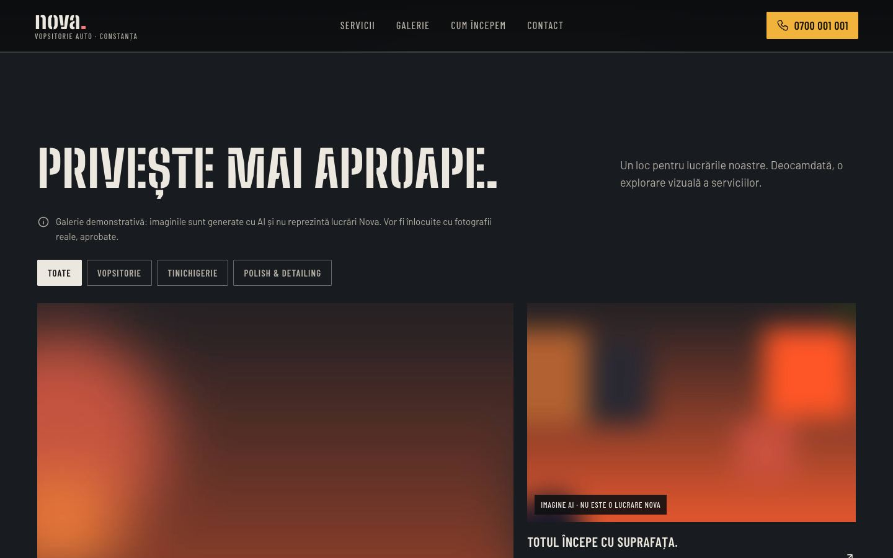

# Nova Vopsitorie

Site de prezentare pentru o vopsitorie auto, cu configurator de culoare 3D.

> Proiect demonstrativ. Firma, adresa, telefoanele, emailurile și recenziile sunt fictive. Orice asemănare cu o firmă reală este întâmplătoare.

## Capturi de ecran

| Prima pagină, telefon | Meniul pe telefon | Galerie |
|---|---|---|
|  |  |  |

## Tehnologii

HTML, CSS și JavaScript, cu three.js pentru configuratorul 3D.

## Decizii tehnice

- Configuratorul de culoare vopsește în timp real un model 3D (glTF „Car Concept”, CC BY 4.0), cu paletă sau cod HEX.
- Modelul a fost comprimat (meshopt, texturi WebP) și inclus ca modul JavaScript, ca să meargă și deschis direct din fișier.
- three.js e servit local din `vendor/`, fără CDN.
- Cu „prefers-reduced-motion” rotația automată se oprește, iar mașina se poate roti și din butoane.
- Accesibilitate: link „Sari la conținut”, mesaje anunțate cititoarelor de ecran (aria-live), focus vizibil la navigarea cu tastatura.
- Animațiile se reduc sau se opresc pentru cine a setat „reducerea mișcării” în sistem (`prefers-reduced-motion`).
- Imaginile din afara ecranului se încarcă abia când e nevoie de ele (`loading="lazy"`).

## Rulare

Site static: deschide `index.html` în browser sau rulează un server local, de exemplu `npx serve .`.

## Cum a fost realizat

Proiectul a fost conceput și dezvoltat de Cristian Lucaci. În procesul de creație am folosit și instrumente de inteligență artificială, ca sprijin la scrierea codului, la texte și la verificări. Deciziile de design, alegerile tehnice și forma finală îmi aparțin.

## Licență

Codul este publicat sub licența [MIT](LICENSE), © 2026 Cristian Lucaci.

Resursele terțe incluse (fonturi, biblioteci, fotografii sau modele 3D cu licență liberă) își păstrează licențele proprii, menționate lângă fișiere sau în pagină. Imaginile fără sursă menționată sunt grafică generată pentru acest proiect.
